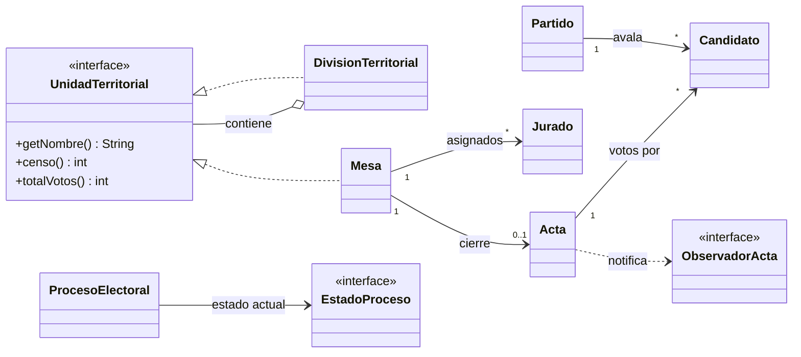

# Sistema de Información Electoral — FIS_2610_Parcial

Sistema de información para la **gestión, transparencia y análisis del proceso electoral en Colombia**, desarrollado como componente práctico del parcial de Fundamentos de Ingeniería de Software (Pontificia Universidad Javeriana, 2026).

> **Estado:** en desarrollo. Este README describe el alcance y el plan de trabajo; se actualiza a medida que se cierran los issues.

## Contexto

En unas elecciones nacionales intervienen autoridades electorales, partidos, candidatos, jurados, testigos y ciudadanos, repartidos en una logística que va del departamento hasta la mesa de votación. La información de ese proceso suele quedar fragmentada entre lo administrativo, lo logístico y los resultados.

Este proyecto modela el escenario completo en un solo sistema para apoyar cinco necesidades: **planeación, seguimiento, auditoría, trazabilidad y analítica de resultados**.

## Alcance funcional

| Etapa | Qué permite el sistema |
|---|---|
| Preparación | Registrar el proceso electoral con su tipo de elección, fecha y estado dentro del calendario |
| Organización territorial | Registrar departamentos, municipios, puestos de votación y mesas, cada mesa con su número y censo |
| Inscripción | Registrar partidos y candidatos, y relacionar cada candidato con el partido que lo respalda |
| Jurados | Asignar jurados a cada mesa y dejar constancia de su función durante la jornada |
| Jornada | Registrar el acta de cierre de cada mesa con los votos por candidato, y las novedades o reclamaciones |
| Análisis | Consolidar resultados por mesa, puesto, municipio y departamento, y comparar entre territorios |

## Modelo de dominio (diseño inicial)



| Entidad | Responsabilidad |
|---|---|
| `ProcesoElectoral` | Tipo de elección, fecha y estado en el calendario electoral |
| `DivisionTerritorial` | Departamento, municipio o puesto de votación; agrupa unidades de nivel inferior |
| `Mesa` | Unidad mínima de votación: número, censo, jurados y acta |
| `Partido` | Organización política que avala candidatos |
| `Candidato` | Persona inscrita en la contienda, asociada a un partido |
| `Jurado` | Ciudadano asignado a una mesa con una función específica |
| `Acta` | Resultado de una mesa al cierre de la jornada: votos por candidato |

## Patrones de diseño GoF

Seis patrones, con al menos uno por categoría. Cada uno responde a una situación concreta del proceso electoral.

| Patrón | Categoría | Situación que resuelve | Clases principales |
|---|---|---|---|
| Factory Method | Creacional | Cada tipo de elección (Senado, Cámara, Presidencial) se crea con sus propias reglas sin que el cliente conozca la clase concreta | `CreadorProceso` y sus subclases |
| Builder | Creacional | El acta se arma paso a paso y solo se construye si es válida (por ejemplo, votos totales ≤ censo de la mesa) | `Acta.Builder` |
| Composite | Estructural | Departamento, municipio, puesto y mesa se tratan de forma uniforme para sumar censo y votos en cualquier nivel | `UnidadTerritorial`, `DivisionTerritorial`, `Mesa` |
| Facade | Estructural | Un único punto de entrada para registrar candidatos, asignar jurados, registrar actas y consultar resultados | `SistemaElectoralFacade` |
| Observer | Comportamental | Al registrar un acta se notifica al consolidado de resultados y a la bitácora de auditoría sin acoplarlos a la mesa | `ObservadorActa`, `ConsolidadorResultados`, `BitacoraAuditoria` |
| State | Comportamental | El proceso solo admite ciertas operaciones según su etapa: Programado → Inscripciones → Jornada → Escrutinio → Cerrado | `EstadoProceso` y sus estados concretos |

## Estructura del proyecto

```
FIS_2610_Parcial/
├── .github/
│   └── modernize/java-upgrade/          # scripts auxiliares de la herramienta de actualización de Java
├── sistema-electoral/                   # proyecto Maven
│   ├── src/
│   │   ├── main/java/co/edu/javeriana/fis/electoral/modelo/    # entidades del dominio
│   │   │   ├── ActaElectoral.java
│   │   │   ├── AsignacionJurado.java
│   │   │   ├── Candidato.java
│   │   │   ├── Departamento.java
│   │   │   ├── Jurado.java
│   │   │   ├── MesaVotacion.java
│   │   │   ├── Municipio.java
│   │   │   ├── PartidoPolitico.java
│   │   │   ├── ProcesoElectoral.java
│   │   │   ├── PuestoVotacion.java
│   │   │   ├── ResultadoElectoral.java
│   │   │   ├── RolJurado.java
│   │   │   └── TipoEleccion.java
│   │   └── test/java/co/edu/javeriana/fis/electoral/modelo/    # pruebas unitarias, una clase por entidad
│   │       ├── ActaElectoralTest.java
│   │       ├── AsignacionJuradoTest.java
│   │       ├── CandidatoTest.java
│   │       ├── DepartamentoTest.java
│   │       ├── JuradoTest.java
│   │       ├── MesaVotacionTest.java
│   │       ├── MunicipioTest.java
│   │       ├── PartidoPoliticoTest.java
│   │       ├── ProcesoElectoralTest.java
│   │       ├── PuestoVotacionTest.java
│   │       └── ResultadoElectoralTest.java
│   ├── .gitignore
│   └── pom.xml
└── README.md
```
## Requisitos y ejecución

- Java 17
- Maven 3.9 o superior

```bash
git clone https://github.com/<usuario-u-organizacion>/FIS_2610_Parcial.git
cd FIS_2610_Parcial
git checkout <rama-del-equipo>

mvn -B clean test      # compila y ejecuta todas las pruebas
```

El reporte de pruebas queda en `target/surefire-reports/`.

## Pruebas unitarias

Las pruebas se escriben con JUnit 5 y siguen estos criterios para cada entidad:

- Al menos **dos pruebas por método** implementado.
- Al menos **una prueba negativa** por entidad: datos inválidos o excepción esperada (por ejemplo, un acta con más votos que el censo de la mesa).
- Al menos **una prueba de caso límite** por entidad: valores extremos o colecciones vacías (por ejemplo, un municipio sin puestos o una mesa con censo cero).

Cada prueba se nombra con el formato `metodo_condicion_resultadoEsperado`.

## Integración continua (CI/CD)

El pipeline está definido en `.github/workflows/ci.yml` y se activa con cada `push` a la rama del equipo.

| Etapa | Qué hace |
|---|---|
| Checkout | Descarga el código de la rama |
| Configurar JDK | Instala Java 17 y restaura la caché de dependencias de Maven |
| Compilar | `mvn -B compile`; falla si el código no compila |
| Probar | `mvn -B test`; falla si alguna prueba unitaria no pasa |
| Publicar reportes | Sube los reportes de Surefire como artefacto de la ejecución |

Ningún cambio se considera terminado si el pipeline no queda en verde.

## Flujo de trabajo

### Scrum con issues de GitHub

- Cada tarea del parcial es un **issue** con responsable y etiqueta (`patron`, `pruebas`, `ci`, `docs`).
- Un issue se cierra desde el commit o el pull request que lo resuelve, con `Closes #<número>`.

### Conventional Commits

Formato: `<tipo>(<ámbito opcional>): <descripción en imperativo>`

| Tipo | Uso | Ejemplo |
|---|---|---|
| `feat` | Funcionalidad nueva | `feat(territorio): agregar jerarquía territorial con Composite` |
| `fix` | Corrección de un error | `fix(acta): rechazar votos negativos` |
| `test` | Pruebas nuevas o ajustadas | `test(acta): cubrir acta sin resultados` |
| `ci` | Cambios del pipeline | `ci: ejecutar pruebas en cada push a la rama del equipo` |
| `docs` | Documentación | `docs: agregar README inicial` |
| `refactor` | Cambio interno sin alterar comportamiento | `refactor(proceso): extraer transiciones de estado` |

## Entregables

- [ ] Implementación de los 6 patrones GoF, con explicación y fragmentos de código
- [ ] Pruebas unitarias por entidad, con evidencia de ejecución
- [ ] Pipeline de CI activo en la rama del equipo, con evidencia de ejecución exitosa
- [ ] Informe de resultados en `docs/`

## Equipo

**Ecobogota — Grupo 4** · rama `<rama-del-equipo>`

| Integrante | Usuario de GitHub |
|---|---|
| Carlos Ney Bernal | `@<usuario>` |
| Pablo Alfonso Jimenez Becerra | `@<usuario>` |
| `<nombre>` | `@<usuario>` |

---

Fundamentos de Ingeniería de Software · Pontificia Universidad Javeriana · 2026
